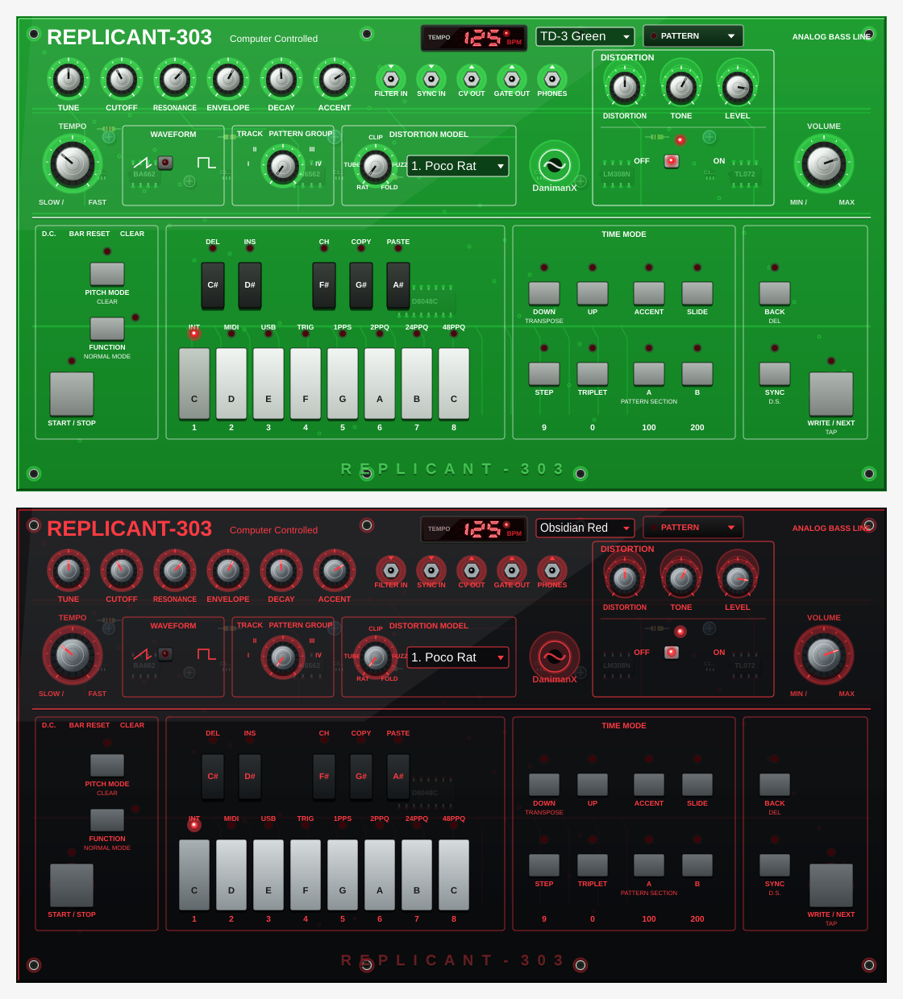

# REPLICANT 303 // Virtual Analog TB-303 Synthesizer

<p align="center">
  <strong>Virtual Analog TB-303 Emulation with Translucent Green &amp; Obsidian Red Panel Skins and a Multi-Distortion Engine</strong><br>
  <em>Audio Plugin: VST3 • AU • Standalone for macOS, Windows, and Linux</em>
</p>

<p align="center">
  
</p>

<p align="center">
  <em>Both ship in the plugin — pick a skin from the selector in the header.</em>
</p>

---

## 🎛️ Overview

**Replicant303** is an authentic virtual analog emulation of the iconic **Roland TB-303**, featuring a procedural 3D interface whose tactile hardware — PCB underlay, translucent acrylic chassis, metal knobs, tactile keys and 80s LED clock — is drawn entirely in code.

The panel ships with two selectable skins, chosen from the selector in the header and saved with the plugin state:

* **TD-3 Green** — inspired by the **Behringer TD-3 Translucent Green** edition.
* **Obsidian Red** — black acrylic panel with red silkscreen lettering, copper traces and knob pointers.

It combines circuit-accurate synthesis (4-pole diode ladder filter, interactive dual envelopes, capacitor-modeled slide, and squelch accent) with an integrated **5-model distortion unit** led by the legendary **ProCo Rat ("Poco Rat")** pedal.

---

## ✨ Key Features

### 🎨 Procedural 3D Interface with Selectable Skins
* **Selectable Skins:** every colour of the panel (acrylic chassis, PCB underlay, silkscreen print, LEDs, 7-segment display, knob metal and tactile keys) comes from a theme table, so new skins are data rather than code. `TD-3 Green` and `Obsidian Red` ship today, selectable from the header and persisted in the plugin state.
* **Procedural 3D PCB Underlay:** Visible circuit board with BA662 VCA, LM308N Op-Amp, AN6562 filter buffer, D8048C CPU, electrolytic capacitors, resistors, and copper traces.
* **Translucent Acrylic:** Mold standoff bosses under every knob and jack, beveled 3D borders, and embossed `REPLICANT - 303` bottom lip.
* **80s Digital LED Tempo Display:** Vintage red 7-segment clock display on deep black recessed acrylic, updating BPM in real time.
* **11 Spun-Aluminum Knobs:** Conical brushed metallic caps, fluted dark skirts, and radial tick markings.
* **13-Key Tactile Keyboard:** Playable via mouse or MIDI, with 13 individual real-time red LEDs.
* **5 Patch Points:** Authentic 1/8" jacks (`FILTER IN`, `SYNC IN`, `CV OUT`, `GATE OUT`, `PHONES`).

### ⚡ Virtual Analog DSP Engine
* **VCO:** Band-limited PolyBLEP Sawtooth and RC-filtered hollow Square wave with classic asymmetric droop.
* **VCF:** 4-pole diode ladder with non-linear $\tanh$ saturation, AC high-pass decoupling, and self-oscillation.
* **Slide:** Continuous 60ms capacitor portamento without envelope re-triggering.
* **Accent:** Dynamic envelope speedup (~200ms) with +4.5 dB boost and squelch bite on velocities $\ge 100$.

### 💣 5 Multi-Distortion Models

| Model | Based On | Sound Character |
|---|---|---|
| **1. Poco Rat** | *ProCo Rat (LM308)* | Symmetrical silicon clipping with op-amp slew limiting and reverse Tone filter. The quintessential Acid Techno drive. |
| **2. Tube Drive** | *Tube Screamer (TS9)* | Warm symmetrical soft clipping with mid-range boost. |
| **3. Hard Clip** | *Boss DS-1* | Hard diode clipping with aggressive odd harmonics for Rave & Industrial. |
| **4. German Fuzz** | *Germanium Fuzz Face* | Asymmetrical vintage fuzz with dynamic touch response. |
| **5. Wavefolder** | *West-Coast Wavefolder* | Complex metallic wave-folding for aggressive modern acid timbres. |

---

## 📦 Downloads & Installation

Download pre-built packages for your operating system from [Releases](https://github.com/DanimanX/Replicant303/releases).

### Plugin Directories

* **macOS:**
  * VST3: `~/Library/Audio/Plug-Ins/VST3/Replicant303.vst3`
  * AU: `~/Library/Audio/Plug-Ins/Components/Replicant303.component`
* **Linux:**
  * VST3: `~/.vst3/Replicant303.vst3` (or `/usr/lib/vst3/`)
* **Windows:**
  * VST3: `C:\Program Files\Common Files\VST3\Replicant303.vst3`

---

## 🛠️ Building from Source

Requires **CMake 3.22+**, **Ninja** or **Make**, and a **C++20** compiler. JUCE 8 is fetched automatically.

```bash
# 1. Clone repository
git clone https://github.com/DanimanX/Replicant303.git
cd Replicant303

# 2. Configure CMake
cmake -B build -G Ninja -DCMAKE_BUILD_TYPE=Release

# 3. Build VST3, AU, and Standalone
ninja -C build
```

### Refreshing the panel screenshots

`generate_snapshot` renders the editor off-screen to a PNG, so the README previews can be
regenerated without opening a DAW. It takes an output path and an optional skin index, and
switches the skin live through the public `ui_theme` parameter before rendering:

```bash
ninja -C build generate_snapshot
generate_snapshot assets/replicant303_ui.png 0                          # TD-3 Green
generate_snapshot assets/replicant303_ui_obsidian_red.png 1             # Obsidian Red
```

---

## 🤖 CI/CD (GitHub Actions)

Automated multi-platform builds run via `.github/workflows/build.yml` on every push and tag:
* **macOS Universal Binary** (Apple Silicon M1/M2/M3/M4 + Intel x86_64)
* **Linux x86_64** (Ubuntu, Debian, Arch, Fedora)
* **Windows x64** (Windows 10 / 11)

---

## ☕ Support

Replicant303 is free and open source. If it earns a place in your setup and you
feel like saying thanks, you can buy me a coffee — completely optional.

<p align="center">
  <a href="https://paypal.me/DanimanX?locale.x=en_US&amp;country.x=CL">
    
  </a>
</p>

<p align="center">
  <sub><a href="https://paypal.me/DanimanX?locale.x=en_US&amp;country.x=CL">paypal.me/DanimanX</a></sub>
</p>

---

## 📄 License

Created by **DanimanX Studio**. Distributed under the **MIT License**.
